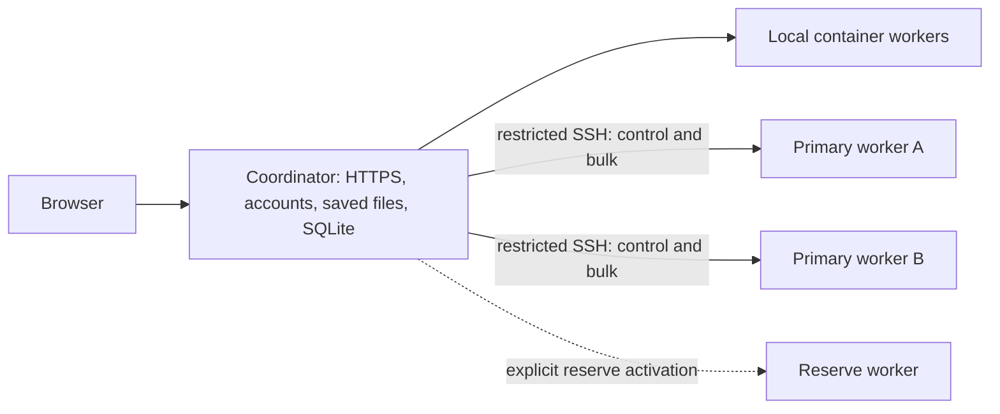

# Add execution workers

Keep one coordinator for the website, accounts, saved source and databases. Add
Linux workers over restricted SSH to run **pure project checks**. The coordinator
continues to run local work; each worker has its own container engine and local
storage. No shared writable filesystem or public worker port is required.

This first rollout distributes build checks, selected-file compilation and native
kernel checks. Editors, agents, terminals, project setup and canonical writes
remain on the coordinator. Moving those workloads requires a separate ownership
and publication protocol. Adding workers does not make the coordinator highly
available.



## Prepare each worker

For a shared machine whose administrator has already provided Docker, the
container slice and AppArmor profile, use the [user account installation](UserExecutionWorkers.md).
It keeps the remaining files and service in the dedicated account's local home.

Ask its administrator to provide:

- Node.js 24 or newer, Python 3, OpenSSH, and local persistent storage.
- A maintained Docker Engine with cgroup v2, the systemd cgroup driver, memory
  and swap enforcement, and a private Unix socket. Follow the
  [Docker Ubuntu installation guide](https://docs.docker.com/engine/install/ubuntu/).
- A dedicated local `leanflow` account with home `/data/leanflow/home` and
  Docker socket access. That access is root-equivalent: keep this account trusted
  and never mount the socket into a job.
- A hard disk and inode boundary covering **all** `/data/leanflow` storage,
  including Docker's data directory, caches and writable jobs. Use inherited
  filesystem project quotas or a separate bounded filesystem. Free-space
  monitoring alone is insufficient. Confirm its actual mechanism and limits.
- The supplied [container slice](../deploy/leanflow-workers.slice), with 16 CPUs,
  48 GiB memory, zero swap and 8,192 tasks in this example. Account-service limits do not
  bound containers created by the rootful Docker daemon.
- AppArmor and the supplied [kernel profile](../deploy/leanflow-kernel-check.apparmor).
  Load it with `apparmor_parser -r`. Retain the supplied seccomp policy. Do not
  disable the host's namespace restrictions or grant privileged containers.

Rootless Podman on AppArmor hosts is rejected because
[upstream rootless AppArmor support is unavailable](https://github.com/containers/common/blob/main/pkg/apparmor/internal/supported/supported.go).
The adapter is not a claim that another engine has passed containment tests.
Every engine, host, image and helper release must pass actual conformance.

For a new account, an administrator can start with:

```sh
install -d -m 0755 /data/leanflow
useradd --user-group --create-home --home-dir /data/leanflow/home --shell /bin/sh leanflow
install -d -o leanflow -g leanflow -m 0700 /data/leanflow/state /data/leanflow/home/.ssh
install -d -m 0755 /data/leanflow/app/releases /data/leanflow/bin /etc/leanflow
usermod -aG docker leanflow
```

Check for an existing local or directory-service account first. Do not modify an
account already used for another purpose. Keep the application, bridge, service
units and configuration root-owned. Put engine storage on the bounded local
volume; NFS home directories are unsuitable. Preserve any existing applications
and container-engine data.

## Install a reviewed release

From a clean coordinator checkout, create a source bundle:

```sh
node scripts/package-cluster-worker.mjs --output /private/release-output
```

The output includes a compressed source archive, its SHA-256 checksum and a
content digest of the host helpers. It contains no Node dependency tree, image,
toolchain, user project, key or configuration. Verify the archive checksum and
inspect its relative paths before an administrator extracts it. Install it in a
new root-owned directory beneath `/data/leanflow/app/releases`, then point
`/data/leanflow/app/current` at that release. Do not overwrite a running release.

Copy [the node configuration](../deploy/leanflow-node.json.example) to
`/etc/leanflow/node.json`, owned by root and readable by `leanflow`. Set the node
ID, enrolled controller lineage and exact `sha256:` image ID. Pin the same image
and source bundle across the enrolled workers. By default the coordinator also
requires its own image and bundle to match. The image contains the Lean
runtime; the host helpers are separately hashed because they are bind mounted.

A coordinator-only website update can retain a separately reviewed and certified
worker release. Set `executionProfile` in the protected controller configuration:

```json
{
  "version": 2,
  "bundleDigest": "WORKER_BUNDLE_SHA256",
  "imageDigest": "sha256:WORKER_IMAGE_SHA256"
}
```

The version is the supported worker protocol version. Both digests must be exact;
this option never accepts arbitrary releases or restores old certification.
Verify protocol compatibility and review worker helper changes before retaining
a profile. Worker fixes require a worker upgrade and fresh conformance. A pinned
profile retains the old release's behavior and limits; it does not apply those
fixes remotely. The maintenance CLI's `--image` must match this profile. Local
work continues to use the coordinator's own configured image. Without this field,
the original matching-image-and-bundle requirement remains in force.
Protocol 2 requires the larger dependency bounds on both peers. Protocol 1 pins
are rejected; upgrade with distributed admission off rather than retaining an
older worker profile during this transition.

Install Node at `/opt/leanflow/node/bin/node`, or adjust both the supplied
[service](../deploy/leanflow-node.service) and
[bridge](../deploy/leanflow-node-bridge) to its administrator-managed absolute
path. Install the bridge as `/data/leanflow/bin/worker-bridge` with mode 0755.
Install the service and slice under `/etc/systemd/system`:

```sh
systemctl daemon-reload
systemctl enable --now leanflow-workers.slice
systemctl enable --now leanflow-node.service
systemctl status leanflow-node.service
```

The daemon can start before its enrolled image is loaded. It stays unavailable
until the engine, resource boundary, pinned image, assets and conformance gates
pass. Starting its service does not activate distributed website traffic.

## Restrict the SSH connection

Generate a separate Ed25519 key per worker on the coordinator. Keep private keys
there with mode 0600. Install only the matching public key on its worker:

```text
restrict,command="/data/leanflow/bin/worker-bridge" ssh-ed25519 PUBLIC_KEY coordinator-to-worker
```

The bridge accepts only `leanflow-node-control` and `leanflow-node-bulk`; these
carry a bounded, framed protocol to the daemon's private Unix socket. They do not
accept shell commands, arbitrary container options or a remote engine API. Keep
password and general interactive access disabled for this service account.

Pin host keys in a private coordinator `known_hosts` file after checking their
fingerprints through an existing trusted connection or with the administrator.
Do not make first-use trust automatic. The client ignores personal SSH config,
disables agents and forwarding, and uses only the enrolled identity.

## Configure and roll out

Copy the [controller configuration](../deploy/leanflow-controller.json.example)
into the coordinator's private data directory. Set a persistent random lineage,
enrolled node IDs, dedicated key paths and verified host keys. Set
`STUDIO_CLUSTER_CONFIG` to its absolute path in the web service environment.
Leave `mode: "off"` until enrollment and fixture checks pass.

Use an idle maintenance window for initial enrollment. Only one process may own
the controller's state. Transfer the pinned image, toolchain and immutable public
dependency assets, then certify each node. Each certification is bound to the
current worker-process epoch, image and helper digest. Repeat certification after
every worker-service restart; previous reports cannot authorize a new process.
An optional `certifyToolchain` configuration pin runs fresh probes automatically
on restart once that toolchain is installed. It never restores old capabilities
without running those probes.
An uncertified operation is never selected; unavailable native checking is never
replaced by a build-only result.

The maintenance CLI requires `mode: "off"` and exclusive ownership of the
controller state. For example, use these commands for each enrolled worker,
substituting your absolute paths, image ID, node ID and pinned toolchain:

```sh
node server/cluster/control.mjs --help
node server/cluster/control.mjs status --config /private/controller.json --data /coordinator/data --image sha256:IMAGE_ID
node server/cluster/control.mjs image --config /private/controller.json --data /coordinator/data --image sha256:IMAGE_ID --node worker-a --archive /private/worker-image.tar.gz
node server/cluster/control.mjs prepare --config /private/controller.json --data /coordinator/data --image sha256:IMAGE_ID --node worker-a --toolchain leanprover/lean4:v4.35.0 --toolchain-dir /coordinator/data/runtime/elan/toolchains/leanprover--lean4---v4.35.0
node server/cluster/control.mjs prepare --config /private/controller.json --data /coordinator/data --image sha256:IMAGE_ID --node worker-a --toolchain leanprover/lean4:v4.35.0 --toolchain-manifest TOOLCHAIN_SHA256 --dependency-dir /coordinator/data/runtime/shared-dependencies/CACHE_KEY
node server/cluster/control.mjs fixture --config /private/controller.json --data /coordinator/data --image sha256:IMAGE_ID --node worker-a --toolchain leanprover/lean4:v4.35.0 --toolchain-dir /coordinator/data/runtime/elan/toolchains/leanprover--lean4---v4.35.0 --operation check.kernel
```

The image archive must be an actual export of the pinned image, at most 2 GiB
compressed. `prepare` runs conformance. `fixture` then checks a synthetic project,
including a selected file that imports its freshly compiled project module, and
requires an invalid proof to fail. No model provider is used. Drain active work
before restarting the website to switch cluster modes.

Pre-stage large environments with `prepare --dependency-dir` while admission is
off. It accepts only a current protected cache under the coordinator's managed
dependency directory with the requested toolchain. Alternatively use
`prepare --dependencies MANIFEST_SHA256` for an already captured dependency
manifest. Both paths transfer and install all assets before checks need them.
Check object-count and byte usage on both hosts: their budgets cover all
toolchains, source snapshots and cached environments together. Leave room for
several versions, rather than matching the object budget to one manifest's cap.
Bulk uploads pipeline at most four objects per worker connection, shared across
concurrent checks. Each chunk remains bounded to 256 KiB. Transfer concurrency
does not increase the worker's CPU, memory or running-check limits.

Start with `shadow`, which starts the local authoritative check immediately and
runs a bounded remote comparison in the background. The local result never
waits for the shadow check. A bounded audit records comparisons; shadow mode
consumes capacity on both hosts.
Inspect comparisons on representative pinned projects, cold caches, concurrent
users, cancellation and connection loss before setting `serve`. Restart the web
service only after active work has finished. Set `off` to stop remote admission;
drain or confirm cancellation before stopping or replacing a worker release.

Reserve nodes have `role: "reserve"` and are excluded unless `allowReserve` is
explicitly enabled. Set their `enabled` flag false when they are not available.
Do not include them in normal capacity claims.

## Resource and failure behavior

The example node admits a 42 GiB RAM pool on a 48 GiB container slice and uses up
to 16 logical CPUs. Ordinary checks reserve 6 GiB and 2 CPUs; native checks reserve
three worker slots. CPU, RAM and scratch fit **one host**; free RAM on another
machine cannot satisfy a large job. Tune these vectors for measured projects,
rather than setting a ceiling on user accounts. Higher per-check memory reduces
parallel work. Provider limits and coordinator editor/agent capacity still apply.

Queues are bounded globally and per account. Placement excludes incompatible,
uncertified, stale, draining and reserve nodes. Source and environment manifests
are hashed; resumed uploads verify their complete digest. Source contains no
credentials or Git metadata. Projects requiring omitted private files or legacy
mutable dependencies keep the existing local check path. Each attempt gets a
private writable Lake cache and a fresh home; public dependencies stay read-only.
Dependency snapshots are limited to 250,000 entries and 64 MiB of manifest
metadata. Source, toolchain and result snapshots retain 150,000 entries and
32 MiB. Large dependency caches can exceed those limits and keep checks local;
measure the actual cache before counting its projects as remote capacity.
The coordinator and workers must both run protocol 2 with these limits. A
protocol 1 execution profile is rejected before connecting.
Capture failures fall back before assignment. Transfer or installation failures
after assignment are reported as check failures; they do not trigger a local retry.
Public Git dependencies carry only generated shallow metadata for their locked
revision and reachable source objects. Original Git configuration, hooks,
credentials and unrelated history are never copied.

Remote scratch is memory backed and shares the job's RAM limit with Lean. Native
checks need room for both their kernel export and replay memory. Compare heavy
projects in shadow mode before serving them remotely; an ordinary build passing
does not establish that a large native check fits.

Attempt IDs are durable and cannot be reused for different inputs. Controller
and node epochs fence old connections and results. Workers stop after leases
expire even when SSH is disconnected. Cancellation is acknowledged only after
container cleanup; uncertain cleanup quarantines the grant and cannot trigger a
local retry. Reconnect or restart reconciliation must confirm cleanup first.

Every host bind in a pure-check container is read-only. Its home, temporary files
and Lake outputs use sized memory-backed filesystems, charged to the job's memory
limit. Docker logging is disabled for these containers; the worker bounds captured
output. The aggregate filesystem boundary still protects images, immutable asset
copies and databases. Native checks run at most one per host while ordinary checks
can use the remaining admitted capacity.

The coordinator object store defaults to 32 GiB and 250,000 objects; each worker
store defaults to 128 GiB and 500,000 objects. Worker `maxStoreBytes`,
`maxStoreFiles` and `reserveBytes` can lower cache limits and increase the free
space left on a shared volume. Asset and source copies reserve their full size
against the measured free-space floor until publication or confirmed cleanup.
These application checks do not create a filesystem quota or reserve disk from
other applications. Reservations charge complete objects
before writes, including interrupted partial uploads. Repeated snapshots reuse
existing content. A full store refuses new objects. Cache eviction is an explicit
idle operation in this release, not a background collector:

```sh
node server/cluster/control.mjs gc --config /private/controller.json --data /coordinator/data --image sha256:IMAGE_ID --node worker-a
```

Use `off` and drain/reconcile all attempts first. The command removes the selected
worker's disposable dependency copies and object cache, clears the coordinator
object cache, and compacts resolved receipts from older controller generations.
It preserves pinned toolchains, current cancellation fences and uncertain work.
Re-prepare dependencies on subsequent checks. Attempts are capped at 100,000
receipts per database; schedule idle maintenance before reaching that limit.

Transferable warm project build caches, automated retention and interactive/batch
priority classes remain rollout work. Measure cold build cost, network transfer
and disk growth before opening a large public pool. Unit tests and a reachable
website do not establish a simultaneous-user capacity.

Back up authoritative coordinator data separately from worker caches. Never
restore an old controller database and silently reuse an enrolled lineage:
create a new lineage and explicitly re-enroll/drain nodes so an old live
controller cannot publish results into the restored service.
